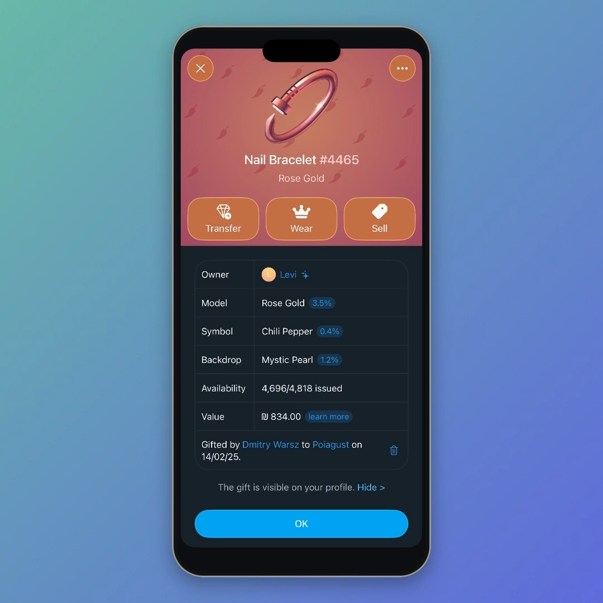

# Gift Lock — Telegram feature proposal

[Watch the 23-second demo](Media/GiftLock-Demo.mp4) · [Submission text](Review/SUBMISSION-MESSAGE.txt)



A runnable native iPhone prototype matching the supplied dark Telegram gift panel for **Nail Bracelet #4465**, with an optional password check before transferring a collectible gift or accepting a purchase offer. It extends the idea of existing withdrawal protection to everyday gift actions.

**Status:** working, offline SwiftUI implementation with a testable policy model. This is not a modified Telegram client, a ready-to-merge Telegram patch, or protection for a real account. Telegram must implement and enforce the proposed policy on its servers before it can protect stolen sessions. No real credentials, account operations, payments, or Telegram account APIs are used. Public gift artwork is downloaded for bundling at development time.

## Try it

1. Open `GiftLock.xcodeproj` in Xcode 16.4 or later (validated with Xcode 26.4.1).
2. Select the **GiftLock** scheme and an iPhone simulator running iOS 17 or later. Press Run. Xcode resolves the pinned official Lottie 4.6.1 package on the first build. No Telegram API keys or account login are needed.
3. Tap **Transfer**, select the fictional sample recipient and continue. Review the gift and zero proceeds, then continue with the password.
4. Enter the fictional password **gift-demo-2026**. A wrong password leaves the local demo copy untouched; the correct one authorizes a transfer in the in-memory demo. The real bracelet is never connected or changed.
5. To test offer acceptance, tap **Sell** (or **Purchase Offers** in the ellipsis menu), then **Review Offer**. The offer and prices are explicitly fictional.
6. Open **Gift Lock · On** in the ellipsis menu to review the setting. Turning it off also requires the sample password. When off, transfers and offers retain their review step.

The ellipsis menu in the upper right offers **Reset Demo** and **Play Demo**. All state is in memory and resets on app relaunch. The normal interactive sample starts with Gift Lock enabled and an assumed existing 2-Step Verification password. The guided video briefly starts with the local copy unlocked, shows the Gift Lock switch being enabled, then proceeds into the bracelet demonstration. That scripted enrollment supplies the known fictional password directly to the same policy service; interactive lock changes still open the password flow. Enrollment and password recovery are outside the prototype.

## What the code actually does

- Matches the supplied dark gift panel with the real Rose Gold bracelet animation, Chili Pepper pattern, backdrop colours, Transfer/Wear/Sell row, attributes and blue OK button; adds local recipient, review, password, error, success and lock-setting screens.
- Runs a deterministic in-memory authority that owns the canonical action, gift, recipient, fee and price.
- Checks the demo password on commit, binds a review to a session and one operation, expires it after 60 seconds, rejects replays and invalidates pending reviews after mutations.
- Limits incorrect password attempts across the two fictional sessions: five failures trigger a 30-second pause.
- Clears the password after each attempt and when the app becomes inactive. Cancels the current review when backgrounded.
- Makes the difference between a sale and a gift transfer explicit; transfers display zero proceeds.

The prototype does not authenticate with Telegram, read a login session, or call any account API. Its Transfer, Sell and authorization controls affect only the in-memory demo service. Public gift metadata remains a reference view; it is not an ownership record from the logged-in account.

The known demo password and local actor are intentional test doubles. They do not provide production authentication or protection against a modified client. The `GiftLockService` protocol is the integration boundary. Production must use remote verification and Telegram's existing SRP implementation, rather than comparing passwords locally.

## Files

| File | Purpose |
| --- | --- |
| `Source/GiftLock/GiftLockApp.swift` | Interactive app, reusable screen flow and guided demo |
| `Source/GiftLock/GiftLockCore.swift` | Service contract, immutable reviews and in-memory reference authority |
| `Tests/GiftLockCoreTests.swift` | Policy tests |
| `TestsUI/GiftLockUITests.swift` | Tests of the actual iPhone interface |
| `Review/ASSESSMENT.md` | Research, realistic verdict and limitations |
| `Review/INTEGRATION.md` | Proposed server contract and integration work |
| `Review/VALIDATION.md` | Observed build, test and video checks |
| `Review/SUBMISSION-MESSAGE.txt` | Message to paste when sending the code and video |
| `Scripts/record-demo.sh` | Repeatable simulator recording instructions |

## Run the tests

Policy tests on macOS:

```sh
swift test
```

UI tests: select the GiftLock scheme in Xcode, choose an iPhone simulator and press **Command-U**. From a terminal:

```sh
xcodebuild -project GiftLock.xcodeproj -scheme GiftLock \
  -destination 'platform=iOS Simulator,name=iPhone 17 Pro' \
  CODE_SIGNING_ALLOWED=NO test
```

Choose an available iPhone simulator on your machine if its name differs. Running on a physical iPhone requires selecting your own signing team in Xcode.

## Demo integrity

The video is a screen recording of this compiled iOS app, framed inside a phone on a gradient background to match the supplied presentation references. Its duration is under 30 seconds. The guided sequence calls the same review and commit methods used by the interactive controls, including wrong-password rejection and an authorized transfer of the in-memory demo copy. It is scripted execution of running code, not a motion-design video. The recording contains real public gift artwork and metadata plus fictional recipients, transactions and sample offer pricing. It does not connect to a Telegram account. The ₪834 reference value reproduces the supplied screenshot and is not a live quote. The 480-Star fee is a sample value, not a claim about Telegram's current fees. A real implementation must show live, authoritative fees and any actual transfer charge.

## Scope and remaining work

Implemented: the screenshot-matched Nail Bracelet detail view with real public animation, sample Stars offer acceptance, free demo transfer to one fictional recipient, lock changes and policy error handling. Not implemented: Telegram networking, SRP, durable server storage, real enrollment/recovery, recipient search, TON amounts, paid-transfer invoices, real marketplace listings, exports or gift destruction/crafting. See `Review/INTEGRATION.md` for requirements before release.

Telegram’s supplied channel welcome message asks for a video of at most 30 seconds, a link to working code, and a title plus description of at most 250 characters. The ZIP is a local handoff/backup; a publicly accessible code repository link is required for the actual submission. The prepared title and description total 199 characters.

The public gift animation and pepper pattern come from https://t.me/nft/NailBracelet-4465. See `ThirdParty/ATTRIBUTION.md` for asset provenance and the renderer’s license. The original Swift code and scripts are MIT licensed; public Telegram artwork is not covered by that license. A legacy chat-pattern asset is retained from the earlier version but is not used by the current interface.

The proposal is suitable for review as a working feature prototype. Telegram's acceptance of it under its ready-to-implement-code requirement is their decision; this package cannot promise selection, payment, or a production rollout.
